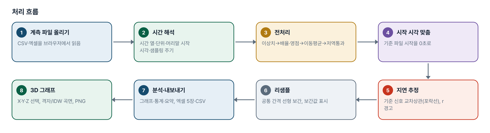
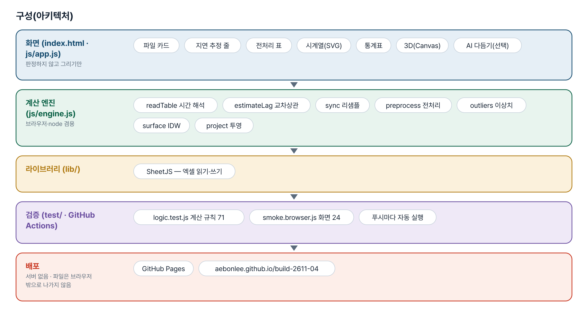
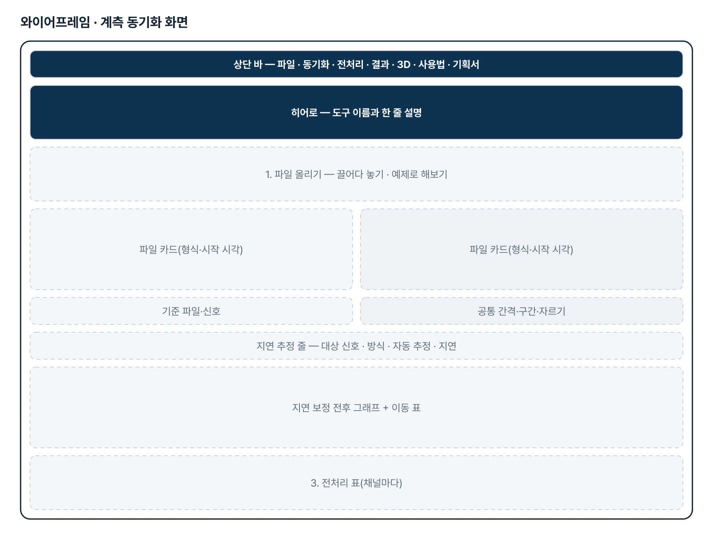
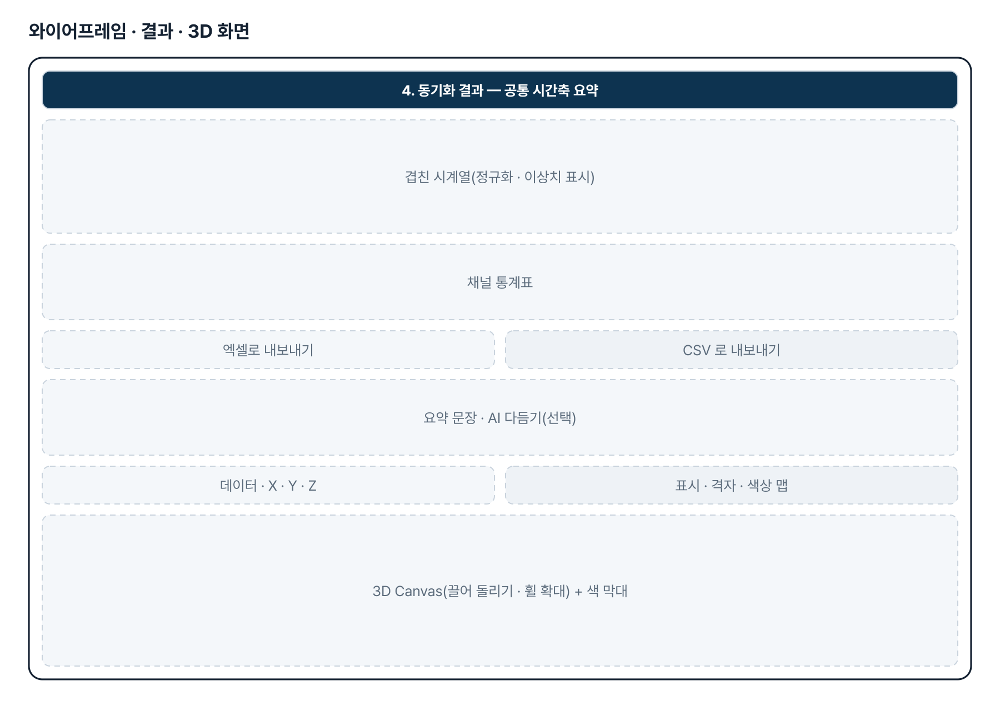
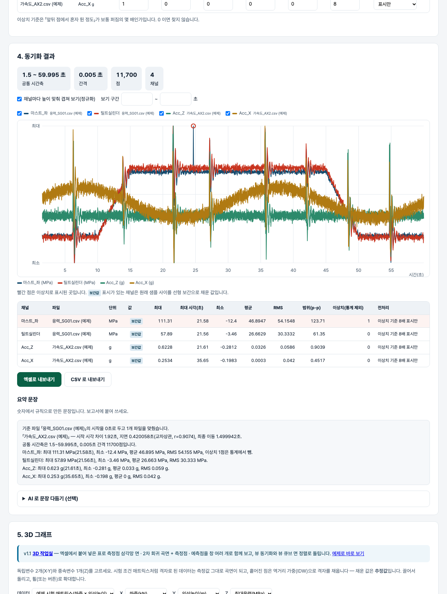

# 계측 데이터 처리 · 3D 그래프 — 프로젝트 기획서 v1.1

- 기획: 노현석 · 작성일 2026-11-04 · 생성형 AI 업무자동화 전문가과정 · 2차수 프로젝트 04
- 바로 쓰기: https://build-2611-04.jobability.co.kr/
- 워드 판: `docs/기획서/build-2611-04_노현석_계측데이터처리3D그래프_기획서_v1.1.docx`

## 개요

샘플링 주기·시작 시각·시간 형식이 다른 계측기 CSV·엑셀을 한 시간축으로 맞추고(시작 시각 + 교차상관 지연 추정 + 선형 보간 리샘플), 전처리·이상치 표시·엑셀 내보내기와 독립변수 2개·종속변수 1개로 돌려 보는 3D 그래프를 만드는 도구입니다.

### 배경 · 현재 업무
- 지게차 구조 내구 검증에서 실차 응력과 가속도를 서로 다른 계측기로 기록합니다.
- 계측기마다 샘플링 주기·시작 시각·시간 형식이 달라 같은 사건끼리 맞추는 작업을 손으로 합니다.
- 계측기 시계가 조금씩 어긋나 시작 시각만 맞춰서는 충격 시점이 겹치지 않습니다.
- Raw Data 전처리(영점·필터·이상치·구간 자르기)와 보고서 작성이 매번 반복됩니다.
- 시험 조건 두 개와 결과 하나를 3D 로 볼 도구가 따로 필요합니다.

### 목표
- 여러 계측 파일을 올리면 시간 형식을 스스로 읽고 한 시간축으로 맞춥니다.
- 남은 어긋남을 교차상관으로 추정하고 근거(r)와 보정 전후 그래프를 보여 줍니다.
- 채널마다 전처리를 정하고 통계·이상치를 정리해 엑셀·CSV 로 내보냅니다.
- 독립변수 2개·종속변수 1개를 골라 회전·확대되는 3D 그래프와 PNG 를 만듭니다.

## 요구사항과 구현

| 기획서 요구 | 구현 |
|---|---|
| 서로 다른 계측기 데이터 Time Sync | 시작 시각 맞춤 → 기준 신호 교차상관 지연 추정(포락선/원신호) → 공통 간격 선형 보간 리샘플 |
| 시간 형식이 제각각 | 날짜+시각 · 시각만(자정 넘김) · 경과 초/ms · 엑셀 일련번호 · 시간 열 없음(샘플링 주기) |
| Raw Data 전처리 자동화 | 배율·오프셋 · 영점 · 이동평균 · 저역통과(앞뒤 두 번) · 이상치 표시/보간 · 구간 자르기 |
| 계측 데이터 자동 분석 | 채널 통계(최대·시각·최소·평균·RMS·p-p, 이상치 제외), 겹친 시계열, 보정 전후 그래프 |
| 보고서 자동 생성 | 규칙 기반 요약 문장 + (선택) AI 다듬기, 엑셀 5장 · CSV |
| 3D 그래프(독립 2 · 종속 1) | 격자면 측정값 곡면, 흩어지면 IDW 보간 곡면 · 산점 · 색상 맵 · 회전·확대 · PNG |
| (v1.1) 기획자 메일 2026-11-04: 삼각형 요소 면 · 회귀 곡면+포인트 · 회귀 곡면에 독립변수 2개를 넣은 값(포인트) 세 그래프를 함께, 뷰 싱크로나이즈와 개별 움직임, 엑셀에서 데이터를 붙여넣으면 전부 구현 | surface.html — 붙여넣기(탭·쉼표·공백, 라벨 칸 허용) → 창 3개(삼각망 면 · 회귀 곡면+측정점 · 회귀 곡면+예측점) + 창 더하기, 뷰 동기화/개별, 뷰 큐브 면 클릭 정렬(FRONT·REAR·LEFT·RIGHT·TOP·BOTTOM), 2차 회귀(최소제곱·R²·RMSE) 또는 계수 직접 입력, 예측값, PNG·엑셀 |
| (v1.1) 패들릿 댓글: 뷰 큐브(주사위 좌표계) 면을 선택하면 그 방향으로 정렬 · 창 여러 개 | cubeFaces/cubeHit — 보이는 면만 투영해 누른 면 판정, CUBE_VIEWS 로 카메라 이동. 창은 격자 배치, 창마다 종류 · PNG · 닫기 |

## 주요 기능

- **파일 읽기** — CSV·TXT·엑셀 여러 개. 구분자와 머리말(시작 시각·샘플링 주기)을 스스로 찾고, 파일 카드에서 시간 열·단위·시작 시각을 고칩니다.
- **시간 동기화** — 시작 시각 차이로 옮긴 뒤 교차상관으로 지연을 추정합니다. r 이 낮거나 최대 지연 끝이면 경고하고, 직접 입력도 됩니다.
- **전처리** — 채널마다 배율·오프셋·영점·이동평균·저역통과·이상치 기준과 처리 방식을 정합니다.
- **결과 그래프·통계** — 정규화 겹쳐 보기, 보기 구간, 채널 켜고 끄기, 이상치 표시. 보간값 채널을 구분합니다.
- **내보내기·요약** — 동기화데이터·처리이력·채널통계·이상치·요약 엑셀, CSV, 요약 문장(선택: AI 다듬기).
- **3D 그래프** — 예제·동기화 결과·표 파일에서 X·Y·Z 를 골라 Canvas 에 직접 투영합니다. 끌어 돌리고 휠로 확대, PNG 저장.
- **(v1.1) 3D 작업실** — 엑셀 붙여넣기 → 삼각망 면 · 회귀 곡면+점 · 예측점 창을 함께, 뷰 동기화 · 뷰 큐브 · 창 더하기 · 회귀식 · 예측 · 엑셀.

## 처리 흐름(파이프라인)

1. **계측 파일 올리기** — CSV·엑셀을 브라우저에서 읽음
2. **시간 해석** — 시간 열·단위·머리말 시작 시각·샘플링 주기
3. **전처리** — 이상치→배율·영점→이동평균→저역통과
4. **시작 시각 맞춤** — 기준 파일 시작을 0초로
5. **지연 추정** — 기준 신호 교차상관(포락선), r 경고
6. **리샘플** — 공통 간격 선형 보간, 보간값 표시
7. **분석·내보내기** — 그래프·통계·요약, 엑셀 5장·CSV
8. **3D 그래프** — X·Y·Z 선택, 격자/IDW 곡면, PNG

## 구성(아키텍처)

- **화면 (index.html · js/app.js)** — 파일 카드 · 지연 추정 줄 · 전처리 표 · 시계열(SVG) · 통계표 · 3D(Canvas) · AI 다듬기(선택)
- **계산 엔진 (js/engine.js)** — readTable 시간 해석 · estimateLag 교차상관 · sync 리샘플 · preprocess 전처리 · outliers 이상치 · surface IDW · project 투영
- **라이브러리 (lib/)** — SheetJS — 엑셀 읽기·쓰기
- **검증 (test/ · GitHub Actions)** — logic.test.js 계산 규칙 71 · smoke.browser.js 화면 24 · 푸시마다 자동 실행
- **배포** — GitHub Pages · aebonlee.github.io/build-2611-04

## 화면 구성(와이어프레임)

## 규칙 · 판정 기준

- 공통축 시각 = 경과 초 + (시작 − 기준 시작) − 지연. 지연 > 0 은 대상이 늦게 찍혔다는 뜻입니다.
- 물리량이 다르면 포락선(1초 추세를 뺀 크기)으로 비교합니다. 예제에서 원신호 r<0.5, 포락선 r>0.7.
- 전처리 순서: 이상치 → 보간 대체(선택) → 배율·오프셋 → 영점 → 이동평균 → 저역통과. 원래 샘플에서 처리한 뒤 리샘플합니다.
- 이상치 = 앞뒤 이웃 평균과의 차가 1.4826×MAD 의 k배(기본 8) 넘는 점. 통계는 이상치를 빼고 냅니다.
- 공통 간격 기본값은 가장 짧은 원래 간격, 20만 점을 넘으면 간격을 늘리고 알립니다.
- 3D: 모든 X×Y 조합이 한 번씩이면 측정 격자, 아니면 IDW(거듭제곱 2) 추정 곡면.
- (v1.1) 삼각망은 들로네(Bowyer–Watson, X·Y 를 범위로 나눠 계산, 같은 자리 점은 하나로, 삼각형은 시계 반대 방향). 보간 없음.
- (v1.1) 2차 회귀 z = a + b·x + c·y + d·x² + e·y² + f·x·y — 최소제곱 정규방정식을 범위로 맞춘 좌표에서 풀고 원래 계수로 되돌린다(질량 0~3500 · 높이 300~4750 처럼 크기 차이가 커도 계수가 되살아난다). 점 6개 미만이면 거절. 계수를 직접 넣으면 「직접 입력」으로 표시.
- (v1.1) 숫자가 아닌 Z(예: Safe)는 라벨 — 곡면·회귀에서 빼고, 사용자가 숫자를 적으면 그 값으로 넣되 빨간 테두리로 표시한다. 예측 x·y 가 측정 범위 밖이면 「외삽」.
- (v1.1) 뷰 큐브: 카메라를 향한 면(법선 깊이 < −0.001)만 보이고, 누른 자리가 든 가장 가까운 면으로 정렬. 동기화가 켜지면 공유 뷰 하나, 끄면 창마다 복사본.

## 검증

- 계산 규칙 테스트 119개 · 화면 연기 테스트 47개 통과
- v1.0 판정 71 · 화면 23 그대로, v1.1 판정 48 · 화면 24 추가.
- 되돌려 확인(v1.1): 중복 점 제거 끄기 0 · 회귀 범위 맞추기 끄기(원 좌표로 정규방정식) 0 · 큐브 보이는 면 판정 끄기 3 · 시계 반대 방향 맞추기 끄기 0 실패 → 원복 119.
- 화면 테스트: 예제 → 창 3 · 라벨 12 · R² 카드 = 엔진 → Safe→40 → TOP 면 단추(동기화) → 큐브 그림 클릭 FRONT → 동기화 끄고 창마다 따로 → 예측·외삽 → 계수 직접 입력·다시 맞추기 → 창 더하기·종류·닫기 → PNG·엑셀 4시트 → 붙여넣기 → 360px → 사용법.

## 이번 판에서 하지 않는 것

- 구조물 수명평가·용접부 피로평가(IIW·BS7608)는 계산 기준 검증이 필요해 이번 판 범위 밖입니다.
- 용접부 각장 설계 프로그램은 하지 않습니다.
- 계측기 전용 바이너리 형식은 직접 읽지 않습니다(CSV·엑셀로 내보내 올림).
- 일정한 지연 하나만 보정합니다. 시계 드리프트는 보정하지 않습니다.
- 물리량이 다른 신호의 지연 추정은 응답 모양만큼 치우칠 수 있어 보정 전후 그래프로 확인해야 합니다.
- (v1.1) 3차 이상 · 비선형 회귀는 하지 않는다(계수 6개 2차까지). 라벨(Safe)의 뜻을 정하지 않는다. 기획자 html(Plotly)은 참고만 했고 라이브러리를 들이지 않았다.

## 다음 단계

- 레인플로 계수 → IIW·BS7608 S-N 곡선 → 누적 손상(기준 검증 후)
- 공통 트리거 채널 맞추기, 드리프트 보정
- FFT·PSD, 대역 통과 필터
- 해석 결과와 같은 시간축 비교(Correlation)
- (v1.1 이후) 기획자 실제 표로 회귀 계수가 엑셀 값과 같은지 대조(메일의 f~a 계수는 정확 2차 데이터 테스트로 복원 확인)

## 버전 이력

- **v1.1** (2026-11-04) — 기획자 메일(2026-11-04, 한신대 메일 「건설기계 AI 역량 강화 프로젝트 관련」, Plotly html 2개 + Mass×Height→Velocity Limit 표 + 2차 회귀 계수 f~a)과 패들릿 글(뷰 큐브 면 정렬 · 창 여러 개) 대응 / 3D 작업실(surface.html · js/surface.js): 붙여넣기 · 삼각망 면 · 2차 회귀 곡면+측정점 · 예측점 · 창 여러 개 · 뷰 동기화/개별 · 뷰 큐브 · 회귀식/계수 입력 · PNG · 엑셀 / 엔진: parsePaste · tableColumnsWithLabels · applyLabelMap · delaunay · quadFit/quadEval/quadStats/quadFormula/regGrid · cubeFaces/cubeHit · sampleLimit / 테스트 판정 71→119 · 화면 23→47
- **v1.0** (2026-11-02) — 첫 판 — 시간 동기화(시작 시각·교차상관·리샘플)·전처리·엑셀 내보내기·3D 그래프 / 기획서 워드 판·파이프라인·아키텍처·와이어프레임 추가
